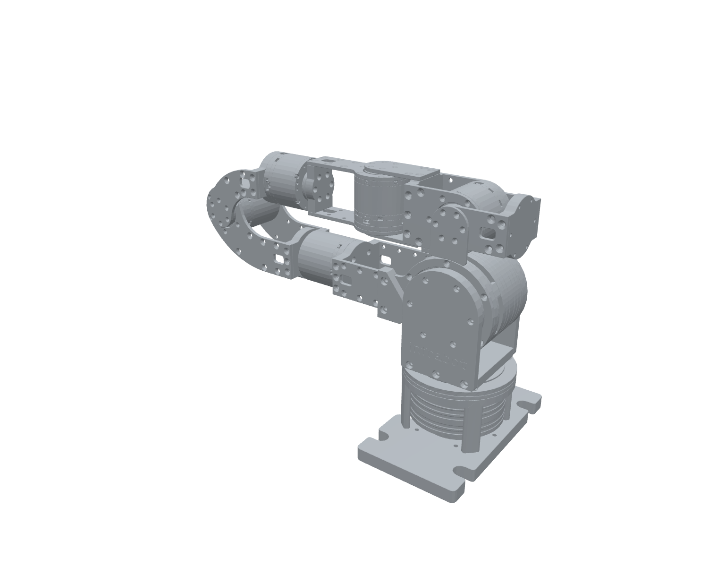

# InfraBot Description

English · [简体中文](README.zh-CN.md)

URDF, meshes and identified dynamics parameters for the **InfraBot H7C** seven-axis arm.



| | |
|---|---|
| Joints | 7 revolute (`Joint_1`–`Joint_7`) + fixed flange |
| Frames | `base_link` → `Link_flange` |
| Mass | 4.627 kg (bare arm, including base) |
| Units | m, rad, kg, kg·m² |

Joint limits, frames, inertia and friction: [docs/model.md](docs/model.md).

## ROS 2

Clone into a workspace and build (targets ROS 2 Jazzy):

```bash
source /opt/ros/jazzy/setup.bash
mkdir -p ~/infrabot_ws/src && cd ~/infrabot_ws/src
git clone https://github.com/YaolinDong/infrabot-description.git
cd ~/infrabot_ws
rosdep install --from-paths src --ignore-src -r -y
colcon build --packages-select infrabot_description
source install/setup.bash
```

View the arm in RViz with joint sliders:

```bash
ros2 launch infrabot_description display.launch.py
```

| Argument | Default | Description |
|---|---|---|
| `gui` | `true` | Show joint sliders |
| `rviz` | `true` | Start RViz |
| `use_sim_time` | `false` | Use simulation time |

Other packages can load the model from `$(find-pkg-share infrabot_description)/urdf/infrabot_h7c.urdf`.

## Without ROS

The URDF uses `package://infrabot_description/...` mesh paths. For loaders that cannot resolve ROS package paths, export a copy with file paths:

```bash
python3 tools/export_urdf.py --output infrabot_h7c.urdf
```

Add `--mesh-paths relative` for paths relative to the output file.

Print link poses for a joint configuration (rad):

```bash
python3 examples/forward_kinematics.py --positions 0 1.2 0 1.5 0 0.4 0
```

Both scripts need only the Python standard library.

## Notes

- `effort` and `velocity` limits are set to 100 for every joint and have not been checked against the motors. Do not use them as control limits.
- Collision geometry uses the visual meshes.
- Friction `offset` and `spring` terms are only in [config/h7c_friction.yaml](config/h7c_friction.yaml); URDF loaders do not apply them.

## License

| Files | License |
|---|---|
| URDF, meshes, model parameters | [CERN-OHL-P-2.0](LICENSE) |
| Scripts, tests, launch and build files | [MIT](LICENSES/MIT.txt) |
| Documentation and images | [CC-BY-4.0](LICENSES/CC-BY-4.0.txt) |

Copyright © 2026 **YaolinDong (董耀琳)** · [dong1505lin@gmail.com](mailto:dong1505lin@gmail.com)
