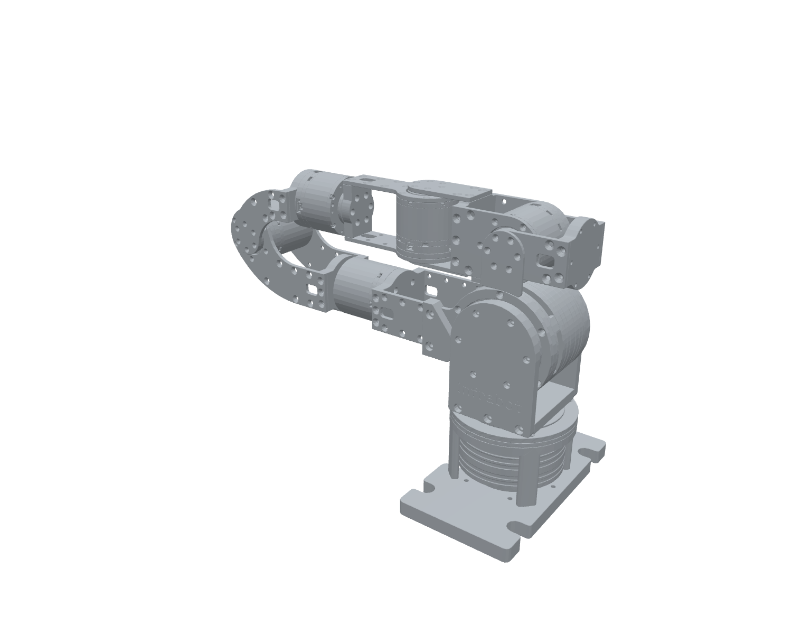

# InfraBot Description

[English](README.md) · 简体中文

**InfraBot H7C** 七轴机械臂的 URDF、网格和辨识动力学参数。



| | |
|---|---|
| 关节 | 7 个转动关节（`Joint_1`–`Joint_7`）+ 固定法兰 |
| 坐标系 | `base_link` → `Link_flange` |
| 质量 | 4.627 kg（裸臂，含底座） |
| 单位 | m、rad、kg、kg·m² |

关节限位、坐标系、惯量和摩擦参数见 [docs/model.md](docs/model.md)。

## ROS 2

克隆到工作空间并编译（适配 ROS 2 Jazzy）：

```bash
source /opt/ros/jazzy/setup.bash
mkdir -p ~/infrabot_ws/src && cd ~/infrabot_ws/src
git clone https://github.com/YaolinDong/infrabot-description.git
cd ~/infrabot_ws
rosdep install --from-paths src --ignore-src -r -y
colcon build --packages-select infrabot_description
source install/setup.bash
```

在 RViz 中查看，带关节滑条：

```bash
ros2 launch infrabot_description display.launch.py
```

| 参数 | 默认值 | 说明 |
|---|---|---|
| `gui` | `true` | 显示关节滑条 |
| `rviz` | `true` | 启动 RViz |
| `use_sim_time` | `false` | 使用仿真时间 |

其他包可以通过 `$(find-pkg-share infrabot_description)/urdf/infrabot_h7c.urdf` 加载模型。

## 不使用 ROS

URDF 中的网格路径是 `package://infrabot_description/...`。不支持 ROS 包路径的加载器可以导出一份文件路径版本：

```bash
python3 tools/export_urdf.py --output infrabot_h7c.urdf
```

加 `--mesh-paths relative` 则使用相对于输出文件的路径。

输出指定关节角（rad）下各连杆的位姿：

```bash
python3 examples/forward_kinematics.py --positions 0 1.2 0 1.5 0 0.4 0
```

这两个脚本只依赖 Python 标准库。

## 注意

- 所有关节的 `effort`、`velocity` 均为 100，未与电机参数核对，不能作为控制限值。
- 碰撞几何直接使用外观网格。
- 摩擦的 `offset`、`spring` 项只在 [config/h7c_friction.yaml](config/h7c_friction.yaml) 中，URDF 加载器不会使用。

## 许可

| 文件 | 许可 |
|---|---|
| URDF、网格、模型参数 | [CERN-OHL-P-2.0](LICENSE) |
| 脚本、测试、launch 和构建文件 | [MIT](LICENSES/MIT.txt) |
| 文档和图片 | [CC-BY-4.0](LICENSES/CC-BY-4.0.txt) |

Copyright © 2026 **YaolinDong（董耀琳）** · [dong1505lin@gmail.com](mailto:dong1505lin@gmail.com)
